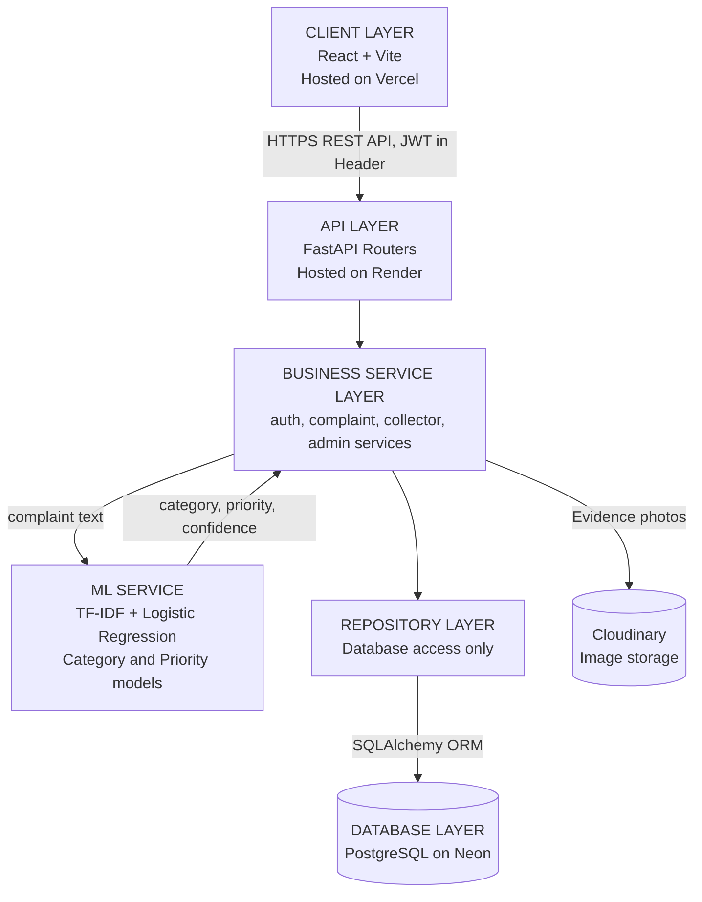

# NammaVoice AI

**Every Citizen's Voice Matters.**

## Live Demo
- Frontend: https://namma-voice-67ijc245r-optimiser.vercel.app
- Backend health check: https://nammavoice-ai.onrender.com/health
- API docs (Swagger): https://nammavoice-ai.onrender.com/docs

## Overview
NammaVoice AI is a civic governance platform where citizens report public infrastructure issues (potholes, garbage overflow, water leaks, broken streetlights) instead of scattering complaints across WhatsApp, calls, and social media. A citizen submits a complaint with a photo, category, and location. It becomes visible to officers in the relevant department, who accept and resolve it. The citizen then confirms whether the fix really worked before it is closed. Collectors and Admins get district-wide and system-wide visibility.

Every new complaint is also read by an AI model that predicts its category and priority, so officers see the most urgent issues first.

## Architecture Diagram



Full ER Diagram and Class Diagram: [`/docs/diagrams`](./docs/diagrams)
Enhancement details: [`Enhancement_Proposal.md`](./Enhancement_Proposal.md)

## Tech Stack

| Layer | Technology |
|---|---|
| Frontend | React (Vite), Axios, React Router, hosted on Vercel |
| Backend | FastAPI, hosted on Render |
| ORM | SQLAlchemy |
| Database | PostgreSQL (Neon, cloud-hosted) |
| Migrations | Alembic |
| Auth | JWT (PyJWT) + bcrypt password hashing |
| Image Storage | Cloudinary |
| Machine Learning | scikit-learn (TF-IDF + Logistic Regression), pandas, joblib |
| Testing | pytest, pytest-mock, pytest-cov |
| CI/CD | GitHub Actions |
| API Docs | FastAPI auto-generated Swagger (`/docs`) |

## Features

**Auth**
- Signup and login for 4 roles: Citizen, Officer, Collector, Admin
- JWT-based sessions, role-aware routing to each dashboard

**Citizen Module**
- Submit a complaint with title, description, category, district, department, and an optional photo, all in one form
- View own complaints with live status
- Confirm or reject a resolution once an officer marks it completed

**Officer Module**
- View unassigned complaints within their department, sorted by predicted priority (High first)
- Accept a complaint (assigns it to themselves)
- Update complaint status
- Every status change is logged to a status-history table

**Collector Module**
- District-wide dashboard: total, pending, and completed complaint counts
- Full list of complaints within their district

**Admin Module**
- List all registered users across the system (role-restricted endpoint)

**AI Module**
- Predicts the complaint category from the description text
- Predicts the priority (High, Medium, Low) from the description text
- Saves a confidence score with each prediction
- Runs automatically when a complaint is submitted

## ML Model Details

| Item | Detail |
|---|---|
| Task | Text classification (category and priority) |
| Method | TF-IDF text features + Logistic Regression, one model per task |
| Categories | pothole, garbage, water_leak, drainage, streetlight, sanitation, illegal_dumping, property_damage |
| Priority levels | high, medium, low |
| Training data | Generated from sentence templates, stored at `backend/ML/data/complaints_dataset.csv` |
| Dataset size | 1,200 rows (80% training, 20% testing) |
| Category accuracy | 100% on 240 test rows (8 categories, 30 rows each) |
| Priority accuracy | 100% on 240 test rows (3 levels, 80 rows each) |

The training data is generated from sentence templates, and the same templates appear in both the training and test sets. The 100% accuracy therefore shows that the training pipeline works correctly. It does not show how the model will perform on real citizen complaints, which use more varied wording. The next step is to evaluate and retrain on real complaints.

## Getting Started

### Prerequisites
- Python 3.10+
- Node.js 18+
- A free [Neon](https://neon.tech) PostgreSQL database
- A free [Cloudinary](https://cloudinary.com) account

### Backend Setup
```
cd backend
python -m venv venv
venv\Scripts\activate
pip install -r requirements.txt
```
Copy `.env.example` to `.env` and fill in your own values.

Run migrations:
```
alembic upgrade head
```
Generate the training data and train the models (the trained files are not stored in Git):
```
python ML/generate_data.py
python ML/train.py
```
Start the server:
```
uvicorn app.main:app --reload
```
Runs at `http://127.0.0.1:8000`. Swagger docs at `http://127.0.0.1:8000/docs`.

### Frontend Setup
```
cd frontend
npm install
npm run dev
```
Runs at `http://localhost:5173`.

## Environment Variables

**Backend**

| Name | Description | Required |
|---|---|---|
| `DATABASE_URL` | Neon PostgreSQL connection string | Yes |
| `SECRET_KEY` | Secret used to sign JWT tokens | Yes |
| `CLOUDINARY_CLOUD_NAME` | Cloudinary account cloud name | Yes |
| `CLOUDINARY_API_KEY` | Cloudinary API key | Yes |
| `CLOUDINARY_API_SECRET` | Cloudinary API secret | Yes |

**Frontend**

| Name | Description | Required |
|---|---|---|
| `VITE_API_URL` | Base URL of the deployed backend | Yes (production only; defaults to localhost) |

## API Documentation
Live Swagger UI: https://nammavoice-ai.onrender.com/docs

## Running Tests
Train the models first (see Backend Setup), because one test loads the real model. Then:
```
cd backend
pytest --cov=app.services --cov-report=term-missing
```
Unit tests cover the service layer (auth, complaint, collector, admin, ML) using mocked repositories, so no real database is needed.

## Deployment
- **Backend**: Render, auto-deploys on push to `main`. Build command: `pip install -r requirements.txt && python ML/generate_data.py && python ML/train.py`
- **Frontend**: Vercel, auto-deploys on push to `main`
- **Database**: Neon (managed PostgreSQL)
- **Image storage**: Cloudinary 
- **CI**: GitHub Actions installs dependencies, generates the data, trains the models, and runs the full test suite on every push and pull request to `main`. See `.github/workflows/backend.yml`

## Folder Structure
```
NammaVoice-AI/
├── .github/workflows/       # CI pipeline
├── backend/
│   ├── app/
│   │   ├── api/             # routers: auth, complaints, officer, collector, admin, reference
│   │   ├── core/            # settings, database connection, security, cloud storage
│   │   ├── models/          # SQLAlchemy models (7 entities)
│   │   ├── schemas/         # Pydantic request/response schemas
│   │   ├── services/        # business logic and ML prediction service
│   │   └── repositories/    # database access layer
│   ├── ML/
│   │   ├── data/            # training dataset (CSV)
│   │   ├── models/          # trained model files (generated, not in Git)
│   │   ├── generate_data.py # builds the training dataset
│   │   └── train.py         # trains and saves the models
│   ├── alembic/             # database migrations
│   └── tests/               # pytest unit tests
├── frontend/
│   └── src/
│       ├── api/
│       └── pages/           # Login, Signup, Citizen/Officer/Collector/Admin dashboards
├── docs/diagrams/           # architecture, ER, and class diagrams
├── Enhancement_Proposal.md
├── problem-statement.md
├── CHANGELOG.md
└── README.md
```

## Future Enhancements
- Duplicate complaint detection, using text similarity and GPS distance between nearby complaints
- Voice complaints: speech converted to text, then sent through the same flow
- Retrain the models on real complaint data
- GPS location capture on complaint submission
- Google/phone-based sign-in
- Structured logging and a monitoring dashboard

## License
No license applied. All rights reserved.

## Author
Daarani, B.Tech AI & Data Science, JJ College of Engineering and Technology